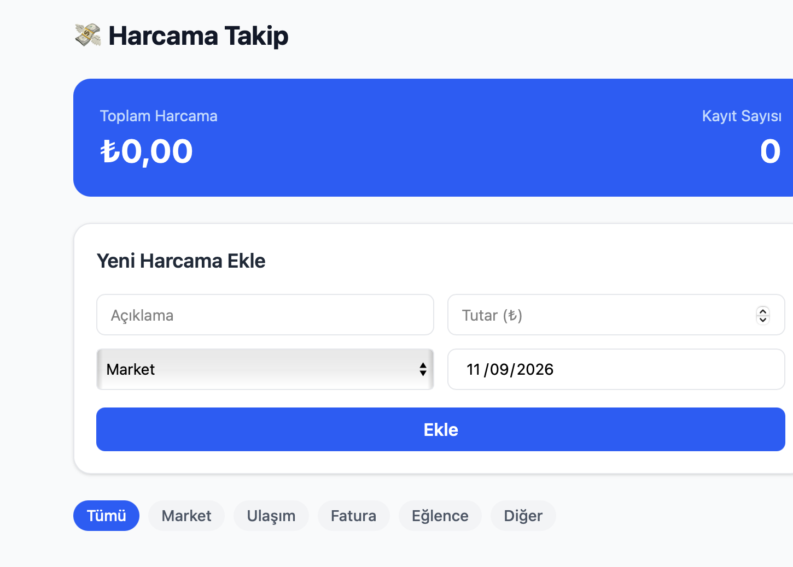

# Harcama Takip

Harcamalarını ekleyip kategoriye göre takip edebileceğin basit bir web uygulaması. Veriler tarayıcıda (LocalStorage) saklanır.

🔗 **Canlı:** <CANLI_URL>



## Özellikler
- Harcama ekleme / silme
- Kategori rozetleri ve filtreleme
- Toplam tutar özeti
- LocalStorage ile kalıcı veri

## Kullanılan Teknolojiler
React, Vite, Tailwind CSS, LocalStorage, Vercel

## Kurulum
```bash
git clone https://github.com/Anill17/harcama-takip
cd harcama-takip
npm install
npm run dev
```

## Yapay Zeka Kullanımı
Proje Claude Code ile geliştirildi:
- **Planlama:** Uygulama fikri, ekranlar ve veri modeli yapay zeka ile çıkarıldı.
- **Kurulum:** Vite + Tailwind kurulumu yapay zeka tarafından yapıldı.
- **Bileşen üretimi:** Form, liste, özet kartı ve filtre bileşenleri yapay zeka ile yazıldı.
- **Hata ayıklama:** Build ve çalışma hataları yapay zeka ile tespit edilip düzeltildi.
- **Yayın:** GitHub'a yükleme ve Vercel'e deploy (Vercel MCP) yapay zeka ile yapıldı.
- **Dokümantasyon:** Bu README yapay zeka ile taslak olarak hazırlandı.

Üretilen kod çalıştırılarak ve elle test edilerek doğrulandı.
